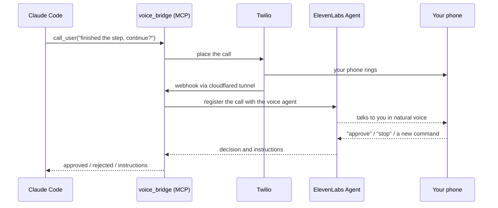

<div align="center">


**[العربية](README.md) · [English](README.en.md)**

    

</div>

<div dir="rtl">

# الوكيل يتصل بك 📞

تخلّي Claude Code يشتغل وتروح تسوي شغلك. وعندما يحتاجك، **يتصل فيك على جوالك ويكلمك صوتياً**: ليخبرك بما أنجز، أو ليأخذ موافقتك قبل خطوة حساسة، أو ليستقبل منك أمراً جديداً وينفذه.

## لماذا تحتاجه؟

| المشكلة | الحل |
|---|---|
| الوكيل يتوقف وينتظر موافقتك وأنت بعيد عن الشاشة | يتصل فيك ويسألك، وتجاوبه بصوتك |
| مهمة طويلة تنتهي ولا تعرف | مكالمة قصيرة تخبرك بالنتيجة |
| تخاف أن ينفذ خطوة خطرة (حذف، نشر، دفع) بدون علمك | **لا ينفذ شيئاً حساساً بدون «موافق» صريحة منك**، وعند أي غموض لا يفترض الموافقة |
| تريد التحكم بعدد المكالمات وأوقاتها | تحدّدها بالكلام: «اتصل فيني بس للموافقات، ومرتين بالساعة» |

## كيف يعمل؟




## المميزات

- 🎙️ **حوار صوتي حقيقي** بالعربية (أو أي لغة) عبر وكيل ElevenLabs، أو رسالة صوتية وردّك بصوتك أو بالأرقام.
- 🛡️ **أمان أولاً**: التعليمات الصوتية تُقرأ عليك وتُؤكَّد قبل أن تصل للوكيل، وعند الغموض لا يُنفَّذ شيء.
- 🎛️ **تحكم كامل**: عدد المكالمات بالساعة، فترة تهدئة للإشعارات، ومتى يتصل، وكلها في ملف المهارة والإعدادات.
- 🧠 **مهارة `phone-call-user`** تعلّم Claude متى يتصل وكيف يكتب الرسالة وكيف يتعامل مع كل نتيجة.
- 🔔 **هوكس** لإشعار قصير عند انتهاء العمل أو عند حاجة Claude لانتباهك.
- 🌐 **يعمل على جهازك أو سيرفرك** بلا نطاق ولا IP ثابت: نفق cloudflared مجاني.
- 🔐 **أسرارك محلية**: المفاتيح في ملف `.env` على جهازك فقط.

## البدء السريع (الطريقة الأسهل: الوكيل يثبّت كل شيء)

1. جهّز حسابين: [Twilio](https://www.twilio.com) (رقم + رقم جوالك موثّق) و[ElevenLabs](https://elevenlabs.io) (مفتاح API بكل الصلاحيات).
2. افتح Claude Code في مجلد مشروعك والصق:

```text
نزّل مشروع الاتصال الصوتي من https://github.com/flymefy/claude-calls-you (git clone)، واقرأ ملف AGENT_INSTALL.md وملف docs/voice-call-guide.pdf، ثم ثبّت النظام وشغّله على هذا الجهاز (أو السيرفر) وسجّل الأداة والمهارة والإشعارات. لا تطلب مني لصق أي مفتاح في المحادثة؛ قل لي أي الحقول أملؤها في ملف .env بنفسي. واسألني قبل أي مكالمة اختبار.
```

3. املأ حقول `.env` التي يحددها لك الوكيل، وأعد تشغيل Claude Code، ثم قل له: **«استخدم call_user واتصل بي»**.

> الدليل المصوّر خطوة بخطوة (Twilio وElevenLabs والتثبيت): [`docs/voice-call-guide.pdf`](docs/voice-call-guide.pdf)

## التثبيت اليدوي

```bash
git clone https://github.com/flymefy/claude-calls-you.git
cd claude-calls-you
python voice_bridge/setup.py            # المكتبات + .env + نموذج الصوت الاحتياطي
# املأ voice_bridge/.env ثم:
python voice_bridge/setup.py --install  # تسجيل الأداة والهوكس والمهارة وقاعدة CLAUDE.md
python voice_bridge/selftest.py check   # فحص بلا تكلفة
```

على ويندوز إن لم يُعرف أمر `claude` في PowerShell: `python voice_bridge/register_mcp.py`.

## الإعدادات الأهم (`voice_bridge/.env`)

| المفتاح | المعنى |
|---|---|
| `TWILIO_ACCOUNT_SID` / `TWILIO_AUTH_TOKEN` | بيانات Twilio |
| `TWILIO_FROM_NUMBER` / `MY_PHONE_NUMBER` | رقم Twilio ورقم جوالك (صيغة دولية `+`) |
| `ELEVENLABS_API_KEY` / `ELEVENLABS_AGENT_ID` | مفتاح ElevenLabs ومعرّف الوكيل الصوتي |
| `NOTIFY_MODE` | `agent` (حوار صوتي) أو `twilio` (رسالة + رد) |
| `TWILIO_SPEECH_LANG` | لغة التعرف على صوتك (مثل `ar-SA`، `en-US`) |
| `MAX_CALLS_PER_HOUR` | الحد الأقصى للمكالمات في الساعة (6) |
| `HOOK_COOLDOWN_SEC` | فترة التهدئة بين مكالمات الإشعار (600) |

## التحكم بالكلام

بعد التثبيت اكتب لوكيلك: **«اتصل فيني بس للموافقات، ومرتين بالساعة كحد أقصى»** وسيعدّل `.env` ومهارة `phone-call-user` بنفسه.

## التكلفة

- **Twilio المجاني**: يتصل برقمك الموثّق فقط، ويسمع رسالة تجريبية قبل الكلام. **المدفوع**: أي رقم وبدون رسالة، وتكلفة بسيطة جداً.
- **ElevenLabs**: حسب حصتك وخطتك. الأسعار تتغير، راجع صفحات الأسعار قبل الدفع.

## الأمان

- لا تشارك ملف `.env` ولا ترفعه (مستثنى في `.gitignore`)، وغيّر مفاتيحك بعد التجارب.
- لا تلصق المفاتيح في المحادثة. الوكيل يخبرك بالحقول لتملأها بنفسك.
- يمكن تفعيل `ENFORCE_SIGNATURE=1` لرفض أي طلب بتوقيع Twilio خاطئ.

## هيكل المشروع

```text
claude-calls-you/
├─ AGENT_INSTALL.md           تعليمات الوكيل للتثبيت
├─ docs/voice-call-guide.pdf  الدليل المصوّر
└─ voice_bridge/
   ├─ server.py               خادم MCP (أداة call_user)
   ├─ bridge.py               المكالمة والنفق والـwebhook ووضع الوكيل الصوتي
   ├─ hook_call.py            هوكس الإشعار
   ├─ setup.py / register_mcp.py / selftest.py
   └─ skill/phone-call-user/  المهارة التي تعلّم Claude متى يتصل
```

## الترخيص

MIT. استخدمه وعدّله بحرية، على مسؤوليتك: راجع ما ينفّذه الوكيل في أي نظام حساس.

</div>
