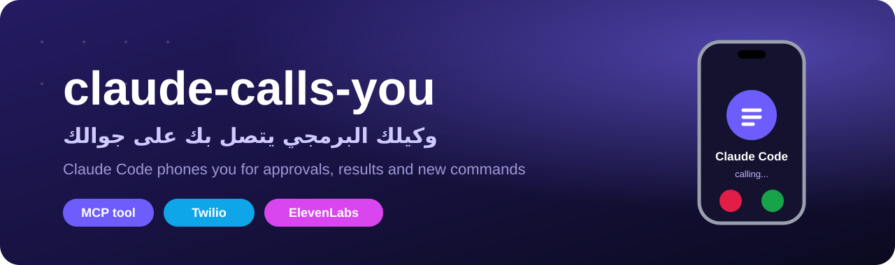
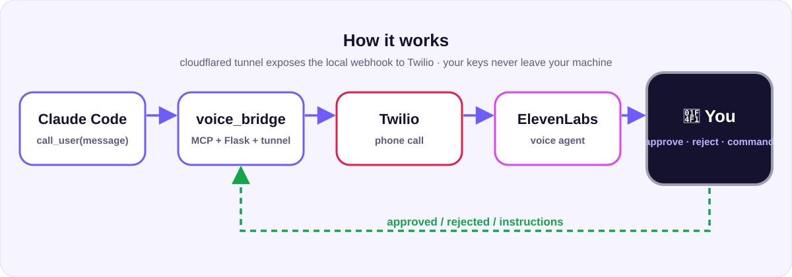
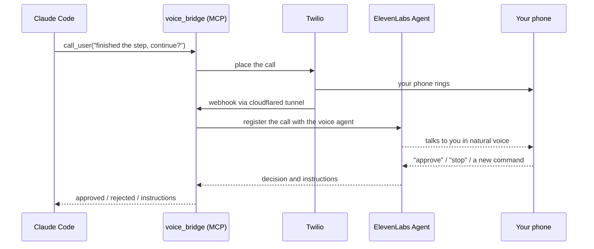

<div align="center">



**[English](#claude-calls-you-) · [العربية](#الوكيل-يتصل-بك-)**

    

</div>

# claude-calls-you 📞

Let your AI coding agent work while you are away. When it needs you, it **phones you and talks**. Built for **Claude Code**, and it works with **any MCP-compatible agent**: Cursor, Codex, Antigravity and more: to report what it finished, to get your approval before a risky step, or to take a new command from your voice.

## Why

| Problem | Solution |
|---|---|
| The agent blocks waiting for approval while you are away | It calls, asks, and you answer by voice |
| A long task finishes and you do not know | A short call tells you the result |
| You fear a risky step (delete, deploy, pay) without consent | **Nothing sensitive runs without an explicit yes**; on any doubt it never assumes consent |
| You want to control call frequency | Say it: "call me only for approvals, twice an hour max" |

## How it works



Claude Code calls the MCP tool `call_user`, `voice_bridge` asks Twilio to dial you, a free `cloudflared` tunnel exposes the local webhook, and an ElevenLabs voice agent talks with you and returns `approved`, `rejected` or `instructions`.

## Quick start (let the agent install everything)

1. Prepare [Twilio](https://www.twilio.com) (a number and your verified phone) and [ElevenLabs](https://elevenlabs.io) (API key with all permissions).
2. In Claude Code, inside your project folder, paste:

```text
Clone https://github.com/flymefy/claude-calls-you, read AGENT_INSTALL.md and docs/voice-call-guide.pdf, then install and configure the voice-call system on this machine (or server), and register the tool, skill and hooks. Never ask me to paste keys in chat; tell me which .env fields to fill myself. Ask before any test call.
```

3. Fill the `.env` fields the agent lists, restart Claude Code, then say: **"use call_user and call me"**.

## Manual install

```bash
git clone https://github.com/flymefy/claude-calls-you.git && cd claude-calls-you
python voice_bridge/setup.py
# fill voice_bridge/.env, then
python voice_bridge/setup.py --install
python voice_bridge/selftest.py check
```

## Features

- Real voice conversation (Arabic or any language) via an ElevenLabs agent, or a recorded message with speech or keypad reply.
- Spoken commands are read back and confirmed before reaching the agent.
- Hourly call cap, hook cooldown, and a `phone-call-user` skill defining when and how to call.
- Runs on your laptop or a server, no domain or static IP needed (cloudflared quick tunnel).
- Secrets stay in a local `.env`.

## Demo video

[Watch / download the 100-second demo (Arabic, 1080x1920)](https://github.com/flymefy/claude-calls-you/releases/download/v1.0.0/claude-calls-you-demo.mp4)

[Download the illustrated guide (PDF, 16 pages)](https://github.com/flymefy/claude-calls-you/releases/download/v1.0.0/voice-call-guide.pdf)

## Works with any agent (Cursor, Codex, Antigravity, ...)

The tool is a standard stdio **MCP server**, so any MCP client can use it. Claude Code gets one-command setup (`setup.py --install` also adds the hooks and the skill). For other agents, add the server and the rule by hand:

```json
{ "mcpServers": { "voice-call": { "command": "python", "args": ["/full/path/to/voice_bridge/server.py"] } } }
```

- **Cursor**: put that entry in `~/.cursor/mcp.json`, and the text of `voice_bridge/skill/phone-call-user/SKILL.md` in a rule (`.cursor/rules/`) or `AGENTS.md`.
- **Codex**: `codex mcp add voice-call -- python /full/path/to/voice_bridge/server.py`, and the skill text in `AGENTS.md`.
- **Antigravity** and other MCP clients: add the same entry in the client's MCP settings, and the skill text in its rules or instructions file.

The Stop/Notification hooks are Claude Code only. Other agents call `call_user` whenever their rules tell them to.

## Security

Never share or commit `.env` (it is git-ignored), rotate keys after testing, and never paste keys in chat.

## License

MIT.

---

<div dir="rtl">

# الوكيل يتصل بك 📞

تخلّي وكيلك البرمجي يشتغل وتروح تسوي شغلك. وعندما يحتاجك، **يتصل فيك على جوالك ويكلمك صوتياً**: ليخبرك بما أنجز، أو ليأخذ موافقتك قبل خطوة حساسة، أو ليستقبل منك أمراً جديداً وينفذه.

## لماذا تحتاجه؟

| المشكلة | الحل |
|---|---|
| الوكيل يتوقف وينتظر موافقتك وأنت بعيد عن الشاشة | يتصل فيك ويسألك، وتجاوبه بصوتك |
| مهمة طويلة تنتهي ولا تعرف | مكالمة قصيرة تخبرك بالنتيجة |
| تخاف أن ينفذ خطوة خطرة (حذف، نشر، دفع) بدون علمك | **لا ينفذ شيئاً حساساً بدون «موافق» صريحة منك**، وعند أي غموض لا يفترض الموافقة |
| تريد التحكم بعدد المكالمات وأوقاتها | تحدّدها بالكلام: «اتصل فيني بس للموافقات، ومرتين بالساعة» |

## كيف يعمل؟




## المميزات

- 🎙️ **حوار صوتي حقيقي** بالعربية (أو أي لغة) عبر وكيل ElevenLabs، أو رسالة صوتية وردّك بصوتك أو بالأرقام.
- 🛡️ **أمان أولاً**: التعليمات الصوتية تُقرأ عليك وتُؤكَّد قبل أن تصل للوكيل، وعند الغموض لا يُنفَّذ شيء.
- 🎛️ **تحكم كامل**: عدد المكالمات بالساعة، فترة تهدئة للإشعارات، ومتى يتصل، وكلها في ملف المهارة والإعدادات.
- 🧠 **مهارة `phone-call-user`** تعلّم Claude متى يتصل وكيف يكتب الرسالة وكيف يتعامل مع كل نتيجة.
- 🔔 **هوكس** لإشعار قصير عند انتهاء العمل أو عند حاجة Claude لانتباهك.
- 🌐 **يعمل على جهازك أو سيرفرك** بلا نطاق ولا IP ثابت: نفق cloudflared مجاني.
- 🔐 **أسرارك محلية**: المفاتيح في ملف `.env` على جهازك فقط.

## البدء السريع (الطريقة الأسهل: الوكيل يثبّت كل شيء)

1. جهّز حسابين: [Twilio](https://www.twilio.com) (رقم + رقم جوالك موثّق) و[ElevenLabs](https://elevenlabs.io) (مفتاح API بكل الصلاحيات).
2. افتح Claude Code في مجلد مشروعك والصق:

```text
نزّل مشروع الاتصال الصوتي من https://github.com/flymefy/claude-calls-you (git clone)، واقرأ ملف AGENT_INSTALL.md وملف docs/voice-call-guide.pdf، ثم ثبّت النظام وشغّله على هذا الجهاز (أو السيرفر) وسجّل الأداة والمهارة والإشعارات. لا تطلب مني لصق أي مفتاح في المحادثة؛ قل لي أي الحقول أملؤها في ملف .env بنفسي. واسألني قبل أي مكالمة اختبار.
```

3. املأ حقول `.env` التي يحددها لك الوكيل، وأعد تشغيل Claude Code، ثم قل له: **«استخدم call_user واتصل بي»**.

> الدليل المصوّر خطوة بخطوة (Twilio وElevenLabs والتثبيت): [`docs/voice-call-guide.pdf`](docs/voice-call-guide.pdf)

## التثبيت اليدوي

```bash
git clone https://github.com/flymefy/claude-calls-you.git
cd claude-calls-you
python voice_bridge/setup.py            # المكتبات + .env + نموذج الصوت الاحتياطي
# املأ voice_bridge/.env ثم:
python voice_bridge/setup.py --install  # تسجيل الأداة والهوكس والمهارة وقاعدة CLAUDE.md
python voice_bridge/selftest.py check   # فحص بلا تكلفة
```

على ويندوز إن لم يُعرف أمر `claude` في PowerShell: `python voice_bridge/register_mcp.py`.

## الإعدادات الأهم (`voice_bridge/.env`)

| المفتاح | المعنى |
|---|---|
| `TWILIO_ACCOUNT_SID` / `TWILIO_AUTH_TOKEN` | بيانات Twilio |
| `TWILIO_FROM_NUMBER` / `MY_PHONE_NUMBER` | رقم Twilio ورقم جوالك (صيغة دولية `+`) |
| `ELEVENLABS_API_KEY` / `ELEVENLABS_AGENT_ID` | مفتاح ElevenLabs ومعرّف الوكيل الصوتي |
| `NOTIFY_MODE` | `agent` (حوار صوتي) أو `twilio` (رسالة + رد) |
| `TWILIO_SPEECH_LANG` | لغة التعرف على صوتك (مثل `ar-SA`، `en-US`) |
| `MAX_CALLS_PER_HOUR` | الحد الأقصى للمكالمات في الساعة (6) |
| `HOOK_COOLDOWN_SEC` | فترة التهدئة بين مكالمات الإشعار (600) |

## التحكم بالكلام

بعد التثبيت اكتب لوكيلك: **«اتصل فيني بس للموافقات، ومرتين بالساعة كحد أقصى»** وسيعدّل `.env` ومهارة `phone-call-user` بنفسه.

## التكلفة

- **Twilio المجاني**: يتصل برقمك الموثّق فقط، ويسمع رسالة تجريبية قبل الكلام. **المدفوع**: أي رقم وبدون رسالة، وتكلفة بسيطة جداً.
- **ElevenLabs**: حسب حصتك وخطتك. الأسعار تتغير، راجع صفحات الأسعار قبل الدفع.

## فيديو الشرح

[شاهد أو حمّل فيديو الشرح (100 ثانية، بالعربية)](https://github.com/flymefy/claude-calls-you/releases/download/v1.0.0/claude-calls-you-demo.mp4)

[حمّل الدليل المصوّر (PDF، 16 صفحة)](https://github.com/flymefy/claude-calls-you/releases/download/v1.0.0/voice-call-guide.pdf)

## يعمل مع أي وكيل (Cursor وCodex وAntigravity وغيرها)

الأداة **خادم MCP** قياسي، فيستخدمه أي وكيل يدعم MCP. مع Claude Code التثبيت بأمر واحد (`setup.py --install` يضيف أيضاً الهوكس والمهارة). مع بقية الوكلاء أضف الخادم والقاعدة يدوياً:

```json
{ "mcpServers": { "voice-call": { "command": "python", "args": ["/full/path/to/voice_bridge/server.py"] } } }
```

- **Cursor**: ضع هذا السطر في `~/.cursor/mcp.json`، ونص `voice_bridge/skill/phone-call-user/SKILL.md` في قاعدة (`.cursor/rules/`) أو ملف `AGENTS.md`.
- **Codex**: `codex mcp add voice-call -- python /full/path/to/voice_bridge/server.py`، ونص المهارة في `AGENTS.md`.
- **Antigravity** وأي عميل MCP آخر: أضف نفس السطر في إعدادات MCP، ونص المهارة في ملف القواعد أو التعليمات.

هوكس Stop وNotification تعمل مع Claude Code فقط. بقية الوكلاء تستدعي `call_user` متى ما أمرتها قواعدها.

## الأمان

- لا تشارك ملف `.env` ولا ترفعه (مستثنى في `.gitignore`)، وغيّر مفاتيحك بعد التجارب.
- لا تلصق المفاتيح في المحادثة. الوكيل يخبرك بالحقول لتملأها بنفسك.
- يمكن تفعيل `ENFORCE_SIGNATURE=1` لرفض أي طلب بتوقيع Twilio خاطئ.

## هيكل المشروع

```text
claude-calls-you/
├─ AGENT_INSTALL.md           تعليمات الوكيل للتثبيت
├─ docs/voice-call-guide.pdf  الدليل المصوّر
└─ voice_bridge/
   ├─ server.py               خادم MCP (أداة call_user)
   ├─ bridge.py               المكالمة والنفق والـwebhook ووضع الوكيل الصوتي
   ├─ hook_call.py            هوكس الإشعار
   ├─ setup.py / register_mcp.py / selftest.py
   └─ skill/phone-call-user/  المهارة التي تعلّم Claude متى يتصل
```

## الترخيص

MIT. استخدمه وعدّله بحرية، على مسؤوليتك: راجع ما ينفّذه الوكيل في أي نظام حساس.

</div>
